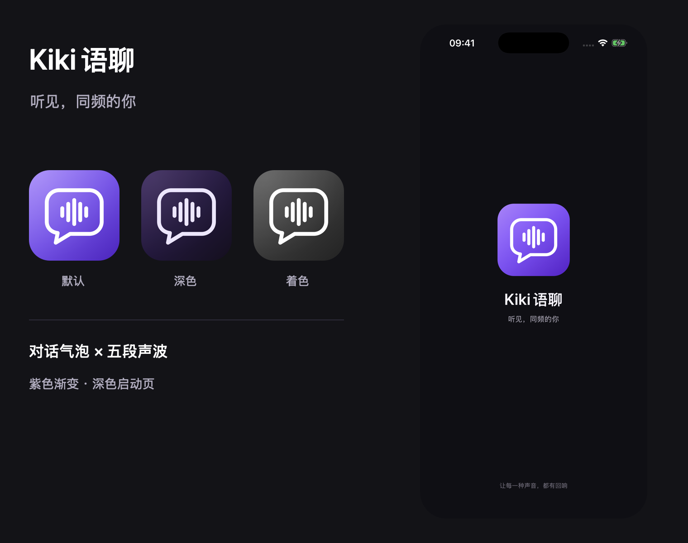
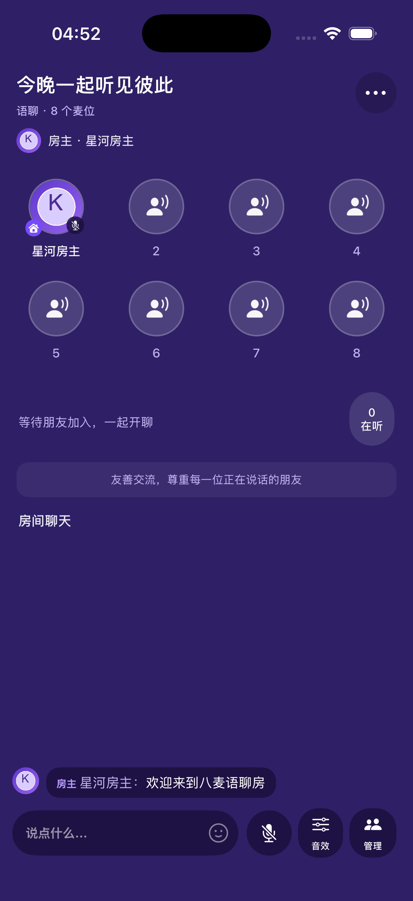

# Kiki语聊：真实功能版

## 实现方案

项目使用两层服务：SwiftUI 提供中文双 Tab 首页、ID 登录、资料与房间入口；现有 TUILiveKit / AtomicXCore 承担真实语聊、直播、麦位、房间消息和互动。业务服务器提供账号、腾讯云 UserSig、资料、房间登记、收藏和浏览历史。客户端不持有腾讯云 SecretKey，也不再生成本地虚构房间或消息。

- **业务服务：** `https://43.138.219.160`，FastAPI + SQLite + systemd，独立系统用户运行。
- **身份：** 仅输入 ID，首次创建账号并绑定当前设备的 Keychain 随机密钥；首次进入必须先设置 1–16 字昵称，完成后进入大厅。旧账号若仍使用 ID 作为默认昵称，也会补充此步骤。会话凭据存储在 Keychain，同一设备重新登录保留资料。
- **音视频：** 服务器签发 UserSig，客户端完成腾讯云登录后加载真实在线房间。SDK 房间控制创建、加入、主播/观众角色、申请上麦、麦克风、摄像头、成员和弹幕。
- **数据：** 资料、收藏、最近 20 次加入记录和创建的房间保存在服务器；房间在线状态以 SDK 返回的实际列表为准。
- **语言：** 中文界面，取消语言选择，不开放 Apple 登录按钮。
- **后续 Apple 登录：** 服务端 `identities` 将认证提供方与业务账号分开。后续添加验证 Apple identity token 的端点并绑定已验证的 `sub`，无需迁移房间和用户资料。当前没有伪造的 Apple 登录实现。

## 用 Xcode 运行

1. 首次安装依赖：

   ```bash
   cd application
   pod install
   ```

2. 使用 Xcode 打开 **`application/RTCube.xcworkspace`**。真实功能版需要 Pods，请使用 workspace。
3. 选择 **KikiTalk** scheme、iPhone 模拟器或真机，按 `⌘R`。
4. 输入自己的账号 ID。两台设备联调使用两个不同的 ID，创建语聊房后另一台设备下拉刷新并加入。
5. 真机首次运行时，在 Signing & Capabilities 中选择自己的开发团队，并允许麦克风/摄像头权限。

最低系统 iOS 17，与当前固定 IP 的 ATS 配置能力一致。Keychain 需要正常签名；模拟器使用 Xcode 的本地签名即可，不要给运行构建设置 `CODE_SIGNING_ALLOWED=NO`。Xcode 缺少 Metal Toolchain 时，先安装系统提示的该组件。

当前 SDK 固定为 AtomicXCore / RTCRoomEngine 4.3.10，以支持 Apple Silicon 模拟器。原 RTCubeLab target 和 SDK 参考代码保留；KikiTalk target 只连接语聊/直播所需模块。

## 图标与启动页



品牌标识由紫色渐变、对话气泡和五段声波组成，提供默认、深色和系统着色三套 App 图标。源图均为 1024×1024、不含透明通道的 sRGB PNG，由 Xcode 生成各设备所需尺寸。

原生启动页使用相同的向量标识、深色背景、品牌名及「听见，同频的你」标语，并适配安全区。恢复账号时沿用同一布局，仅在实际等待期间显示进度，不额外延长启动时间。启动页源文件为 `application/Demo/KikiLaunchScreen.storyboard`。

已通过模拟器与真机构建，并在 iPhone 17 Pro 模拟器检查桌面图标和冷启动。上图右侧来自实际原生启动页截图，单独预览见 [启动页截图](images/kiki-launch-screen.png)。

图形源路径保存在 `tools/generate_kiki_brand.swift`，可在仓库根目录重新生成资源：

```bash
swift tools/generate_kiki_brand.swift
```

## 使用流程

新版语聊房实机尺寸预览（模拟器实际运行截图，头像和消息来自专用测试账号）：



- **大厅：** 切换语聊/直播，按话题筛选、搜索标题或房主，下拉刷新；只显示真实在线房间，没有在线房间时提供创建入口。房间卡片显示累计观看人次，房内成员以 SDK 实时显示为准。
- **创建：** 输入房名，选择话题和氛围。先向服务器登记，再由 SDK 真正创建房间；失败会显示原因，不插入假房间。
- **加入：** 点击在线房间进入真实 SDK 界面。语聊采用参考图的紫色布局，两行四列共 8 个麦位（包含房主），展示真实听众和头像聊天气泡；支持申请上麦、下麦、静音、锁麦、房主管理、关注和消息。顶部更多操作可退出或结束房间。直播支持主播摄像头及观众观看，浮窗与回到房间沿用 SDK 行为。
- **语聊最小化：** 点击房间右上角的收起按钮，或「更多 → 最小化，继续收听」，全屏聊天室收起为应用内全局悬浮球。可以继续浏览大厅、切换「我」和编辑资料；悬浮球支持拖动、左右吸边与键盘避让，点击即可返回原聊天室，点击同一个房间卡片也可返回。最小化保留房间连接、麦位、静音和聊天记录，上麦时也继续保持当前麦克风状态；若要真正离开，请回到房间选择「离开房间」或「结束语聊」。仍在房间时不能创建或加入另一个房间，房间结束、被踢出或账号退出后自动清除悬浮球。
- **收藏：** 长按大厅房间卡片收藏，在「我 → 我的收藏」查看。已结束的房间保留为记录，再次加入时会检查实际状态。
- **我：** 从相册选择头像或使用预设头像，编辑昵称和多行简介；查看收藏、加入记录、自己的房间。相册只授权所选照片，保存前在本地预览、修正方向并裁成正方形，点击保存后上传 JPEG。服务端再次验证图片、去除元数据并保存 512×512 头像，资料同步音视频用户信息。取消编辑不会上传图片；只修改昵称不会清除已保存的相册头像。
- **账号：** 设置中可退出登录；注销要求输入当前 ID 确认，成功后删除服务端账号、会话和个人资料库。相同 ID 再注册会获得新的音视频身份。

语聊麦位和直播功能使用真实腾讯云服务，按所开通的云产品计费。当前云应用尚未配置可用的礼物目录与支付结算，因此 Kiki 房间关闭商业礼物入口，保留真实聊天和点赞。KTV 点歌和跨房 PK 入口也已关闭。

当前 ID 认证绑定设备，不能仅凭已存在的 ID 从其他设备冒用账号。设备迁移、账号找回和 Apple 登录属于后续身份功能；没有用公开 ID 直接签发他人会话的接口。

## 服务与密钥

SSH 私钥已移出下载目录，位于本机 `~/.ssh/kikitalk_server.pem`，权限 `0600`。使用：

```bash
ssh kikitalk-server
```

专用连接配置为 `~/.ssh/kikitalk.conf`，主机公钥固定在 `~/.ssh/kikitalk_known_hosts`。腾讯云凭据仅保存在本机 `~/.config/kikitalk/server.env` 和服务器 `/etc/kikitalk/server.env`，均不加入仓库。

业务数据库在服务器 `/var/lib/kikitalk/kikitalk.sqlite3`，部署目录 `/opt/kikitalk`，服务名 `kikitalk`。部署、备份、API 和证书更新说明见 [服务端说明](../backend/README.zh-CN.md)。

App 使用随包的公开 DER 证书固定校验服务器，服务器私钥不发给客户端。当前证书有效期至北京时间 2027-10-16 03:11；换证时需要更新 App 的固定证书。将来使用正式域名可改为标准公开 CA 证书方案。

自定义头像保存于服务器 `/var/lib/kikitalk/avatars`，图片 URL 使用随机文件名，供其他房间成员公开读取，不携带 Bearer。个人页与大厅使用固定证书图片客户端；SDK 原生头像的 Kingfisher 下载器也使用同一固定证书校验，仅处理该指定服务器，其余站点保持系统默认验证。替换、改回预设或注销时删除旧头像，备份包含数据库和头像文件。

对于该固定 IP 的私有信任锚，Info.plist 仅配置 `43.138.219.160` 的 ATS 规则；业务客户端依然强制 HTTPS、TLS 1.2 以上、前向保密、精确证书匹配，并验证 IP、有效期和签名，拒绝重定向。其他地址保持系统 ATS 规则。iOS 17 起支持按 IP 配置规则，见 [Apple 的 NSExceptionDomains 文档](https://developer.apple.com/documentation/BundleResources/Information-Property-List/NSAppTransportSecurity/NSExceptionDomains)。

## 验证命令

已验证业务 API、资料与收藏持久化，以及两台模拟器使用不同账号完成真实语聊房间的创建、发现、加入和消息收发；主播端已实际收到另一台设备发送的消息。新版 8 麦界面已实测首次昵称、相册选图/预览/上传、房内相册头像、静音、锁麦/解锁、消息气泡，以及访客申请上麦→房主同意→进入第 2 麦位。另一个独立测试完成视频房间在腾讯云上的创建、列表发现与结束，并清理测试账号。视频测试没有生成假画面；摄像头采集及双机音视频效果仍需在真机上联调。无可用摄像头的模拟器会明确提示使用真机开播。

悬浮球独立联调已通过：顶部按钮最小化、球外触摸穿透、非 key 窗口、sheet 上点击与连点恢复同一控制器、8 麦及静音/消息保持、阻止加入其他房间，以及真实房间结束后的悬浮球与状态清理。该验证使用专用随机账号，结束后删除账号和房间数据。

普通 iOS 测试 17 项通过，另外 4 项需要真实云服务的集成测试默认跳过；服务端 22 项通过。需要再次联调时，可在测试进程设置 `KIKI_TEST_ROOM_ID`，让访客加入已开启的语聊房，另设 `KIKI_TEST_REQUEST_SEAT=1` 可申请第 2 麦位并等待房主手动同意；设置 `KIKI_TEST_VIDEO=1` 可单独验证视频房间云端生命周期；`KIKI_TEST_PROFILE=1` 验证首次昵称约束、真实 JPEG 上传、业务与 SDK 两种头像下载器，以及云端 8 麦配置；`KIKI_TEST_FLOATING=1` 在未登录的专用 QA 模拟器中验证真实房间最小化、麦位/静音/聊天保持、sheet 上恢复同一控制器、防止切房和结束后清理（需预先允许麦克风）。集成测试会创建并清理专用测试账号。

```bash
# iOS API 合约与房间模型测试
xcodebuild -workspace application/RTCube.xcworkspace \
  -scheme KikiTalk \
  -destination 'platform=iOS Simulator,name=iPhone 17 Pro' \
  CODE_SIGNING_ALLOWED=YES CODE_SIGN_IDENTITY=- test

# 服务端行为和权限测试
backend/.venv/bin/python -m pytest -q backend/tests

# 公网 HTTPS 状态
curl --cacert backend/deploy/server.crt https://43.138.219.160/health
```

## 主要文件

| 文件 | 职责 |
| --- | --- |
| `application/Demo/KikiLoginView.swift` | ID 登录与错误反馈 |
| `application/Demo/KikiAPIClient.swift` | HTTPS API、证书校验、Keychain |
| `application/Demo/KikiDemoStore.swift` | 真实登录态、房间列表合并、资料和收藏同步 |
| `application/Demo/KikiRTCService.swift` | SDK 登录、真实房间创建/加入、权限和退出回调 |
| `application/Demo/KikiVoiceRoomFloatingOverlay.swift` | 语聊全局悬浮球、触摸穿透、拖动与键盘避让 |
| `application/Demo/KikiDemoRootView.swift` | 双 Tab 和真实房间大厅 |
| `application/Demo/KikiCreateRoomView.swift` | 创建表单和输入校验 |
| `application/Demo/KikiProfileView.swift` | 资料、记录、退出和注销 |
| `backend/app/main.py` | 账号、会话、资料、房间元数据和个人资料库 API |
| `backend/app/usersig.py` | 腾讯云 UserSig 服务端签发 |
