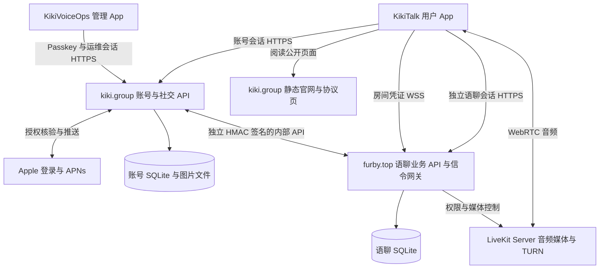

# KikiTalk 项目结构与接手指南

更新日期：2026-10-22（iOS 清理、工程分组及通知内容偏好发布）。面向准备逐步接手开发和运维的项目所有者。

> 当前通知内容偏好已发布：账号代码、两端 `2026-10-22-r13` 协议与官网八个配套页面上线，18 项正常 TLS 公网核验通过。主 App `1.0.21 (18)` 的 Debug 与 Release device（未签名）构建通过，iPhone 全量 353 项（9 跳过、0 失败）、iPad 通知专项 40 项通过；新增开关及前台内容需要安装新版 App，现有用户需重新确认 r13，本轮未进行真机通知发送验证。完整版本、测试与部署证据见 [系统通知记录](APNS.zh-CN.md)。

> 历史：2026-10-22 较早服务端补齐发布，语聊 API 同步当时 `main.py` 与新增 `room_catalog.py`，上线房主修改房间名称、默认房间名称及房间目录变更等待接口。账号业务源码、两端 r12 协议与官网 68 个文件当时均与本地一致；账号 HTTP/2 依赖声明已同步，已安装包版本一致，无需升级依赖或重启账号服务。当时主 App 为 `1.0.16 (13)`，iOS 界面变更仍需安装新版 App。
>
> 发布前本地账号 423 项、语聊 453 项测试通过。发布后语聊源码、两端公网健康、目录接口匿名 401、数据库完整性与外键、目录表及触发器均通过；Nginx 配置与环境凭据保持原值。语聊回滚源码位于服务器私有目录 `/root/kiki-p0-releases/20261022T082603720297Z/previous`；账号依赖声明备份位于 `/root/kiki-source-sync/20261022T082603720297Z/previous`。未回灌数据库或用真实账号发送测试消息。

当前 KikiTalk 由 **iOS 用户客户端、iOS 管理客户端、账号与社交服务、语聊业务服务、LiveKit 媒体服务、静态官网** 组成。两个 Python 后端分别运行在两台主机上；语聊业务 API 与 LiveKit 媒体进程运行在同一台语聊主机上。

项目最初基于腾讯 TUIKit，当前主 App 使用 **Apple 登录、自建业务 API、开源 LiveKit 语音**。2026-10-22 已移除腾讯组件/示例、旧 target 与 Pods、LegacyTencent、独立实验 iOS 副本及 vendor 快照；清理前版本可从 Git 快照追溯。两个当前 App 已统一迁入 `ios/KikiTalk`、`ios/KikiVoiceOps`，用户工程由 RTCube 更名为 KikiTalk。当前代码结构见[架构说明](ARCHITECTURE.zh-CN.md)和[iOS 导航](../ios/README.md)。

本指南描述当前工作区源码。现有部署记录用于说明服务分工；本次 iOS 清理没有发布后端或修改正式协议。应用版本以工程 MARKETING_VERSION / CURRENT_PROJECT_VERSION 及实际 App 产物为准；部分功能与协议变更仍标为本地待发布，不能据此推定现网已经运行相同版本。

## 1 项目全景

| 组成 | 主要代码位置 | 技术栈 | 负责的事情 |
| --- | --- | --- | --- |
| iOS 用户客户端 KikiTalk | `ios/KikiTalk/Sources/` | Swift、SwiftUI、UIKit、Combine、LiveKit Swift SDK | 语聊、动态、消息、个人页、登录、资料、礼物、通知 |
| iOS 管理客户端 KikiVoiceOps | `ios/KikiVoiceOps/` | Swift、SwiftUI、系统 Passkey、URLSession | 账号与语聊看板、社区治理、房间问题查询 |
| 账号与社交服务 | `backend/` | Python 3.11+、FastAPI、SQLite、HTTPX | Apple 身份、账号会话、资料、关系、动态、私聊、APNs、运维身份和授权 |
| 语聊业务服务 | `experiments/livekit/backend/` | Python、FastAPI、SQLite、LiveKit Server API、WebSocket | 房间目录、准入、八麦、房内权限、聊天、公告、礼物、拉黑及语聊治理 |
| 实时媒体服务 | 外部 `livekit-server` 二进制；配置在 `experiments/livekit/infra/` | LiveKit Server、Go、WebRTC、Opus、TURN | 音频传输、转发、订阅与网络穿透；SFU 指选择性转发媒体的服务器 |
| 官网与协议页 | `website/dist/`、`legal/` | 静态 HTML、CSS、SVG、Python 生成脚本 | 产品介绍、隐私和用户协议、SDK 与权限说明、运维隐私说明 |

### 服务之间怎样连接



音频不会经过账号服务。语聊业务 API 管理谁能入房、谁能开麦；LiveKit 执行媒体连接和转发。HTTPS/WSS 信令与 WebRTC 音频是不同的通信链路，排查“能进房但听不到声音”时需要分别检查。

## 2 仓库目录地图

仓库根目录为 `/Users/lihao/code/Xcode/kikitalk/TUIKit_iOS`。

```text
TUIKit_iOS/
├── ios/
│   ├── README.md               两个 iOS 工程导航
│   ├── KikiTalk/               用户 App，KikiTalk.xcworkspace / KikiTalk scheme
│   │   ├── Sources/App/        应用入口、Root、AppStore、启动准备
│   │   ├── Sources/Core/       网络、存储、通知、诊断与设计基础
│   │   ├── Sources/Features/   Authentication/Privacy/VoiceRooms/Gifts/Social/Moments/Messaging/Profile
│   │   ├── Tests/              镜像 App/Core/Features，另有 Integration
│   │   ├── Resources/          Assets、礼物、协议、启动页与隐私清单
│   │   └── Configuration/      Info.plist、entitlements
│   └── KikiVoiceOps/           独立管理 App，KikiVoiceOps.xcworkspace / KikiVoiceOps scheme
│       ├── Sources/            App/Core/Features（Dashboard/Community/Diagnostics）
│       ├── Tests/              Authentication/Dashboard/Community/Diagnostics/Integration/Fixtures
│       ├── Resources/          图标、隐私清单
│       ├── Configuration/      Info.plist、entitlements
│       └── Scripts/            工程和图标生成脚本
├── backend/                    当前账号、社交、APNs、中央运维身份服务
│   ├── app/                    Python 应用
│   ├── tests/                  单元及 API、跨服务测试
│   └── deploy/                 账号服务部署、Nginx、systemd 和配置模板
├── experiments/livekit/
│   ├── backend/                当前正式语聊业务服务
│   ├── infra/                  媒体/API 部署、维护、备份、探针
│   ├── shared/                 跨服务契约、协议副本
│   └── validation/             本地生成验收证据，未纳入 Git
├── website/dist/               可直接部署的静态官网
├── legal/documents.json        正式主线协议源文件
├── tools/                      协议、礼物、品牌资源和说明材料生成工具
├── docs/                       当前说明与按日期归档的规划/交付记录
├── output/                     本地生成资料输出，未纳入 Git
└── AGENTS.md                   项目协作及版本递增约定
```

**`experiments/livekit` 的名字仍来自实验阶段，但其后端和基础设施已被正式主线使用。** 用户端与管理端统一在 `ios/`；后端、infra/shared 保持原目录，不随 iOS 工程移动。独立实验 App 与腾讯参考组件已删除，历史目录名不能作为删除剩余服务的依据。

## 3 iOS 用户客户端

### 工程与开发方式

打开 [KikiTalk.xcworkspace](/Users/lihao/code/Xcode/kikitalk/TUIKit_iOS/ios/KikiTalk/KikiTalk.xcworkspace)，选择 **KikiTalk**，测试 target 为 **KikiTalkTests**。最低 iOS 17，支持 iPhone 和 iPad，工程使用 Swift 5 语言模式；这表示编译设置，不代表必须安装某个旧版 Swift 编译器。

主入口是 [KikiTalkApp.swift](/Users/lihao/code/Xcode/kikitalk/TUIKit_iOS/ios/KikiTalk/Sources/App/KikiTalkApp.swift)。原 Demo 入口文件已按职责更名为 KikiTalkApp、KikiRootView 和 KikiAppStore。当前四个页签为“语聊、动态、消息、我”。

界面以 SwiftUI 为主，房间呈现、窗口和浮层等场景使用 UIKit。状态通过 `ObservableObject`、`@Published` 和 Combine 驱动；网络和生命周期逻辑使用 `async/await`、Task、`@MainActor`。HTTP 使用系统 `URLSession`，JSON 使用 `Codable`；本地会话使用 Keychain。

主 target 通过 **Swift Package Manager** 引入 LiveKit，精确版本见[SPM 锁文件](/Users/lihao/code/Xcode/kikitalk/TUIKit_iOS/ios/KikiTalk/KikiTalk.xcworkspace/xcshareddata/swiftpm/Package.resolved)。旧腾讯参考 target、CocoaPods 配置及工作区 Pods 引用已移除，开发和测试使用 KikiTalk scheme。

### 主要业务代码

下列文件位于 `ios/KikiTalk/Sources/` 的 App、Core 和 Features 子目录，链接对应整理后的实际源码。

| 阅读入口 | 主要职责 |
| --- | --- |
| [KikiRootView.swift](/Users/lihao/code/Xcode/kikitalk/TUIKit_iOS/ios/KikiTalk/Sources/App/KikiRootView.swift) | 协议门禁、启动准备、登录和首次昵称、四页签主界面 |
| [KikiAppStore.swift](/Users/lihao/code/Xcode/kikitalk/TUIKit_iOS/ios/KikiTalk/Sources/App/KikiAppStore.swift) | 主业务状态中心，串起账号、资料、房间、社交、刷新、续租、退出与隐私撤回 |
| [KikiAccountAPIClient.swift](/Users/lihao/code/Xcode/kikitalk/TUIKit_iOS/ios/KikiTalk/Sources/Core/Networking/KikiAccountAPIClient.swift) | 请求 `kiki.group`：Apple 登录、资料、社交、动态、私聊、推送、协议、换取语聊会话 |
| [KikiAPIClient.swift](/Users/lihao/code/Xcode/kikitalk/TUIKit_iOS/ios/KikiTalk/Sources/Core/Networking/KikiAPIClient.swift) | 请求 `furby.top`：房间、麦位、聊天、礼物、收藏、足迹、安全治理；也定义共享模型 |
| [KikiRTCService.swift](/Users/lihao/code/Xcode/kikitalk/TUIKit_iOS/ios/KikiTalk/Sources/Features/VoiceRooms/Services/KikiRTCService.swift) | 连接 LiveKit、音轨和麦克风、成员事件、重连、房间呈现和媒体退出 |
| [KikiLiveKitRoomView.swift](/Users/lihao/code/Xcode/kikitalk/TUIKit_iOS/ios/KikiTalk/Sources/Features/VoiceRooms/Views/KikiLiveKitRoomView.swift) | 当前语聊房界面：八麦、成员、消息、公告和房间操作 |
| [KikiRoomRuntime.swift](/Users/lihao/code/Xcode/kikitalk/TUIKit_iOS/ios/KikiTalk/Sources/Features/VoiceRooms/Services/KikiRoomRuntime.swift) | 房间生命周期、聊天同步、音频中断及路由、网络诊断 |
| [KikiSeatRequestSheet.swift](/Users/lihao/code/Xcode/kikitalk/TUIKit_iOS/ios/KikiTalk/Sources/Features/VoiceRooms/Views/KikiSeatRequestSheet.swift) | 举手与上麦审批面板 |
| [KikiRoomMessageInput.swift](/Users/lihao/code/Xcode/kikitalk/TUIKit_iOS/ios/KikiTalk/Sources/Features/VoiceRooms/Chat/KikiRoomMessageInput.swift) | 房间输入组件；相关文件处理键盘退出和消息展示 |
| [KikiSocialModels.swift](/Users/lihao/code/Xcode/kikitalk/TUIKit_iOS/ios/KikiTalk/Sources/Features/Social/KikiSocialModels.swift)、[KikiSocialViews.swift](/Users/lihao/code/Xcode/kikitalk/TUIKit_iOS/ios/KikiTalk/Sources/Features/Social/KikiSocialViews.swift) | 用户主页、关系、消息入口、站内通知、举报及数据模型 |
| [KikiMomentsViews.swift](/Users/lihao/code/Xcode/kikitalk/TUIKit_iOS/ios/KikiTalk/Sources/Features/Moments/KikiMomentsViews.swift) | 动态、图片、点赞、评论、发布和详情 |
| [KikiDirectMessages.swift](/Users/lihao/code/Xcode/kikitalk/TUIKit_iOS/ios/KikiTalk/Sources/Features/Messaging/KikiDirectMessages.swift)、[KikiInboxConversationRow.swift](/Users/lihao/code/Xcode/kikitalk/TUIKit_iOS/ios/KikiTalk/Sources/Features/Messaging/KikiInboxConversationRow.swift) | 私聊详情和会话行，消息展示及列表操作 |
| [KikiGifts.swift](/Users/lihao/code/Xcode/kikitalk/TUIKit_iOS/ios/KikiTalk/Sources/Features/Gifts/KikiGifts.swift)、[KikiGiftViews.swift](/Users/lihao/code/Xcode/kikitalk/TUIKit_iOS/ios/KikiTalk/Sources/Features/Gifts/KikiGiftViews.swift) | 免费体验钻石、礼物、装饰、赠送与效果播放 |
| [KikiProfileView.swift](/Users/lihao/code/Xcode/kikitalk/TUIKit_iOS/ios/KikiTalk/Sources/Features/Profile/KikiProfileView.swift)、[KikiSettingsLayout.swift](/Users/lihao/code/Xcode/kikitalk/TUIKit_iOS/ios/KikiTalk/Sources/Features/Profile/KikiSettingsLayout.swift) | 个人资料、设置、收藏与足迹等 |
| [KikiLegal.swift](/Users/lihao/code/Xcode/kikitalk/TUIKit_iOS/ios/KikiTalk/Sources/Features/Privacy/KikiLegal.swift)、[KikiLegalViews.swift](/Users/lihao/code/Xcode/kikitalk/TUIKit_iOS/ios/KikiTalk/Sources/Features/Privacy/KikiLegalViews.swift) | 协议读取、版本和同意记录、撤回与展示 |
| [KikiPush.swift](/Users/lihao/code/Xcode/kikitalk/TUIKit_iOS/ios/KikiTalk/Sources/Core/Notifications/KikiPush.swift)、[KikiStartupPermissions.swift](/Users/lihao/code/Xcode/kikitalk/TUIKit_iOS/ios/KikiTalk/Sources/App/KikiStartupPermissions.swift) | APNs、系统通知权限、启动网络检查、通知点击导航 |
| [KikiIncidents.swift](/Users/lihao/code/Xcode/kikitalk/TUIKit_iOS/ios/KikiTalk/Sources/Core/Diagnostics/KikiIncidents.swift) | 建房、入房及运行异常的关联记录和上报 |

AppStore 保留跨页业务状态和服务编排，RootView 保留门禁与导航。原集中源码中的若干完整顶层类型已抽为独立文件：

| 新阅读入口 | 职责 |
| --- | --- |
| [KikiPalette.swift](../ios/KikiTalk/Sources/Core/DesignSystem/KikiPalette.swift)、[KikiAvatar.swift](../ios/KikiTalk/Sources/Core/DesignSystem/KikiAvatar.swift) | 共用颜色、预设头像绘制与自定义头像加载 |
| [KikiIdentityStorage.swift](../ios/KikiTalk/Sources/Core/Storage/KikiIdentityStorage.swift)、[KikiHTTPSDelegate.swift](../ios/KikiTalk/Sources/Core/Networking/KikiHTTPSDelegate.swift) | 身份存储/Keychain，以及HTTPS重定向策略 |
| [KikiRoom.swift](../ios/KikiTalk/Sources/Features/VoiceRooms/Models/KikiRoom.swift) | 房间模型和标题规则 |
| [KikiDiscoverView.swift](../ios/KikiTalk/Sources/Features/VoiceRooms/Discovery/KikiDiscoverView.swift)、[KikiRoomCover.swift](../ios/KikiTalk/Sources/Features/VoiceRooms/Discovery/KikiRoomCover.swift) | 大厅、房间卡片与封面 |
| [KikiDecoratedAvatar.swift](../ios/KikiTalk/Sources/Features/Gifts/KikiDecoratedAvatar.swift)、[KikiUnreadRequestGate.swift](../ios/KikiTalk/Sources/Features/Messaging/KikiUnreadRequestGate.swift) | 装饰头像、未读请求协调 |
| [KikiRoomHostingController.swift](../ios/KikiTalk/Sources/Features/VoiceRooms/Presentation/KikiRoomHostingController.swift) | UIKit房间host与场景生命周期 |
| [KikiRoomDiagnosticsView.swift](../ios/KikiTalk/Sources/Features/VoiceRooms/Views/KikiRoomDiagnosticsView.swift)、[KikiRoomAnnouncementView.swift](../ios/KikiTalk/Sources/Features/VoiceRooms/Views/KikiRoomAnnouncementView.swift) | 诊断与公告辅助界面 |

这些文件仍在同一 App target 编译；Social、Profile、网络DTO和部分测试仍集中多项职责，本轮没有将全部大文件拆解为独立模块。管理端也按 App/Core/Features 组织，配置与资源独立。

Apple 登录使用 AuthenticationServices；音频使用 AVFoundation 和 LiveKit；通知使用 UserNotifications/APNs；图片选择和处理使用 PhotosUI、UIKit、CoreImage、ImageIO 等系统框架。这些系统框架不属于另行下载的第三方开源依赖。

当前开放语音房，视频直播请求在业务层被拒绝；旧视频、美颜、会议和通话组件已移除。资源中的品牌图标/配色与业务代码独立，Info.plist 和 entitlements 统一放在 Configuration。

## 4 iOS 管理客户端

管理 App 是单独的应用，工程为 [KikiVoiceOps.xcworkspace](/Users/lihao/code/Xcode/kikitalk/TUIKit_iOS/ios/KikiVoiceOps/KikiVoiceOps.xcworkspace)，scheme 为 **KikiVoiceOps**，Bundle ID 为 `com.kikitalk.voiceops`。最低 iOS 17，Swift 5 语言模式，当前工程版本为 **1.0（1）**。

它使用 SwiftUI、Foundation、AuthenticationServices、Security/Keychain 和 UIKit 等系统能力，当前没有额外接入腾讯 SDK、LiveKit SDK 或第三方网络库。

| 核心代码 | 职责 |
| --- | --- |
| [KikiVoiceOpsApp.swift](/Users/lihao/code/Xcode/kikitalk/TUIKit_iOS/ios/KikiVoiceOps/Sources/App/KikiVoiceOpsApp.swift) | App 入口、前后台生命周期与后台页面遮罩 |
| [OpsStore.swift](/Users/lihao/code/Xcode/kikitalk/TUIKit_iOS/ios/KikiVoiceOps/Sources/App/OpsStore.swift)、[OpsViews.swift](/Users/lihao/code/Xcode/kikitalk/TUIKit_iOS/ios/KikiVoiceOps/Sources/Features/Dashboard/OpsViews.swift) | 管理状态、看板选择和界面 |
| [PasskeyAuthorization.swift](/Users/lihao/code/Xcode/kikitalk/TUIKit_iOS/ios/KikiVoiceOps/Sources/Core/Security/PasskeyAuthorization.swift) | 系统通行密钥创建与登录 |
| [OpsIdentityAPI.swift](/Users/lihao/code/Xcode/kikitalk/TUIKit_iOS/ios/KikiVoiceOps/Sources/Core/Networking/OpsIdentityAPI.swift)、[OpsTransport.swift](/Users/lihao/code/Xcode/kikitalk/TUIKit_iOS/ios/KikiVoiceOps/Sources/Core/Networking/OpsTransport.swift) | 固定账号域名的管理请求与传输校验 |
| [SessionVault.swift](/Users/lihao/code/Xcode/kikitalk/TUIKit_iOS/ios/KikiVoiceOps/Sources/Core/Security/SessionVault.swift)、[OpsServiceModels.swift](/Users/lihao/code/Xcode/kikitalk/TUIKit_iOS/ios/KikiVoiceOps/Sources/Core/Models/OpsServiceModels.swift) | Keychain 运维会话、服务和权限模型、请求允许列表 |
| [OpsCommunityView.swift](/Users/lihao/code/Xcode/kikitalk/TUIKit_iOS/ios/KikiVoiceOps/Sources/Features/Community/OpsCommunityView.swift)、[OpsModeration.swift](/Users/lihao/code/Xcode/kikitalk/TUIKit_iOS/ios/KikiVoiceOps/Sources/Features/Community/OpsModeration.swift) | 语聊举报、限制和社区处置 |
| [OpsSocialModeration.swift](/Users/lihao/code/Xcode/kikitalk/TUIKit_iOS/ios/KikiVoiceOps/Sources/Features/Community/OpsSocialModeration.swift) | 账号服务中的动态、私聊等社交治理 |
| [OpsIncidents.swift](/Users/lihao/code/Xcode/kikitalk/TUIKit_iOS/ios/KikiVoiceOps/Sources/Features/Diagnostics/OpsIncidents.swift) | 房间技术问题查询与展示 |

管理 App 统一向 **`kiki.group/admin/v2`** 注册、登录和请求数据。账号服务器保存运维身份、公钥、会话和权限；需要语聊数据时，由账号服务器签名请求 `furby.top`。App 不直接拿运维 Bearer 登录语聊服务器。

权限分为 `account`、`voice` 和 `community`。新注册者默认没有权限，包括第一位注册者；负责人通过账号服务器本地 CLI 授权。账号和语聊看板权限只读，社区权限允许相应治理操作。早期“两个服务各输一个口令”“管理端只有只读功能”的描述已经不适用于完整现状。详见 [运维账户说明](/Users/lihao/code/Xcode/kikitalk/TUIKit_iOS/docs/OPS_PASSKEYS.zh-CN.md) 与 [社区治理说明](/Users/lihao/code/Xcode/kikitalk/TUIKit_iOS/docs/P0_COMMUNITY_SAFETY.zh-CN.md)。

## 5 账号与社交服务

### 服务职责和模块

账号服务位于 [backend](/Users/lihao/code/Xcode/kikitalk/TUIKit_iOS/backend)，是一个按业务拆分 Python 模块的 FastAPI 应用。入口为 [main.py 中的 create_app](/Users/lihao/code/Xcode/kikitalk/TUIKit_iOS/backend/app/main.py:464)，并非为每个模块单独启动进程。

| 模块 | 职责 |
| --- | --- |
| [main.py](/Users/lihao/code/Xcode/kikitalk/TUIKit_iOS/backend/app/main.py) | 配置、数据库、账号与会话、协议、资料、头像、注销、限流、路由装配 |
| [apple_auth.py](/Users/lihao/code/Xcode/kikitalk/TUIKit_iOS/backend/app/apple_auth.py) | Apple JWT 验证、授权码兑换、加密凭据和授权撤销 |
| [voice_bridge.py](/Users/lihao/code/Xcode/kikitalk/TUIKit_iOS/backend/app/voice_bridge.py) | 账号换取语聊会话，退出、撤回与注销的跨服务可靠投递 |
| [social.py](/Users/lihao/code/Xcode/kikitalk/TUIKit_iOS/backend/app/social.py) | 用户公开资料、关注关系、通知、屏蔽策略及拉黑代理 |
| [social_content.py](/Users/lihao/code/Xcode/kikitalk/TUIKit_iOS/backend/app/social_content.py) | 私聊、会话置顶和本人清理、动态、图片、赞评、举报和社交处置 |
| [push.py](/Users/lihao/code/Xcode/kikitalk/TUIKit_iOS/backend/app/push.py) | 直接调用 APNs、设备绑定、持久待发队列、重试和点击解析 |
| [ops_auth.py](/Users/lihao/code/Xcode/kikitalk/TUIKit_iOS/backend/app/ops_auth.py) | 运维 Passkey、会话、权限、授权 CLI、跨服务管理代理 |
| [admin.py](/Users/lihao/code/Xcode/kikitalk/TUIKit_iOS/backend/app/admin.py) | 账号看板、主机资源、证书、服务状态与备份统计 |
| [activity.py](/Users/lihao/code/Xcode/kikitalk/TUIKit_iOS/backend/app/activity.py)、[maintenance.py](/Users/lihao/code/Xcode/kikitalk/TUIKit_iOS/backend/app/maintenance.py) | 活跃统计、备份状态读取 |
| [voice_incidents.py](/Users/lihao/code/Xcode/kikitalk/TUIKit_iOS/backend/app/voice_incidents.py)、[community_content.py](/Users/lihao/code/Xcode/kikitalk/TUIKit_iOS/backend/app/community_content.py) | 技术问题转投、基础文字过滤 |

`gifts.py`、`usersig.py` 和部分旧房间 API 属于腾讯兼容实现。根 gifts 仍保留旧版本兼容端点，当前主 App 的礼物请求走语聊服务。正式桥接模式启用时，账号服务不再向主客户端签发腾讯 UserSig；旧房间、收藏和历史入口会要求迁移到语聊服务。表和代码保留不等于现行主 App 仍在使用它们。

### 数据保存在什么地方

当前使用 Python 标准库 `sqlite3`，SQL 直接写在源码里；数据库启用 WAL 与事务。没有在这套实现中使用 ORM、PostgreSQL、Redis 或 Celery。

| 数据类别 | 主要表或文件 |
| --- | --- |
| 用户与 Apple 身份 | `accounts`、`identities`、`apple_*` |
| 账号会话和授权代次 | `sessions`、`session_apple_grants` |
| 协议同意与撤回 | `legal_consent_events`、`legal_withdrawal_receipts` |
| 社交业务 | `social_*`：关系、私聊、动态、图片元数据、赞评、通知、清理水位、举报及处置 |
| 推送 | `push_installations`、`push_devices`、`push_outbox` |
| 运维身份 | `ops_accounts`、`ops_credentials`、`ops_challenges`、`ops_sessions`、`ops_grants`、`ops_audit` |
| 跨服务可靠任务 | `voice_revocation_outbox`、`voice_incident_outbox` |
| 图片文件 | 头像和社交图片存本机磁盘，数据库保存相关引用 |

普通业务 Bearer 在数据库保存哈希；Apple 刷新令牌加密保存。跨服务 outbox 是数据库中的待办队列，用于让远端临时失败的撤销、删除或问题上报稍后重试，并没有另用一套消息队列产品。

账号库拥有社交数据，但**统一个人拉黑关系的权威在语聊服务**。普通社交请求会获取未缓存的签名屏蔽策略；语聊策略接口不可用时，相应社交操作可能返回 503。这是排查“账号登录正常，但动态或私聊打不开”时需要知道的跨服务依赖。

## 6 语聊业务与媒体服务

### 自己维护的语聊业务代码

代码在 [experiments/livekit/backend](/Users/lihao/code/Xcode/kikitalk/TUIKit_iOS/experiments/livekit/backend)。它与根账号后端分别启动、分别存库；业务通过签名内部 API 协作。

| 模块 | 职责 |
| --- | --- |
| [main.py](/Users/lihao/code/Xcode/kikitalk/TUIKit_iOS/experiments/livekit/backend/app/main.py) | 配置、会话、数据库、房间准入、麦位动作和权限、生命周期、路由与后台任务 |
| [rtc.py](/Users/lihao/code/Xcode/kikitalk/TUIKit_iOS/experiments/livekit/backend/app/rtc.py) | 封装 LiveKit Server API，创建房间、调整权限、移除成员、发送同步提示 |
| [signal_gateway.py](/Users/lihao/code/Xcode/kikitalk/TUIKit_iOS/experiments/livekit/backend/app/signal_gateway.py) | 可撤销的 LiveKit 信令入口，核验当前会话、入场代次和权限 |
| [account_bridge.py](/Users/lihao/code/Xcode/kikitalk/TUIKit_iOS/experiments/livekit/backend/app/account_bridge.py) | 接收账号授权、租约、续期、撤销和注销的签名请求 |
| [seating.py](/Users/lihao/code/Xcode/kikitalk/TUIKit_iOS/experiments/livekit/backend/app/seating.py) | 排队、持久审批状态、自动补位与麦位整理 |
| [chat.py](/Users/lihao/code/Xcode/kikitalk/TUIKit_iOS/experiments/livekit/backend/app/chat.py) | 房内文字、递增序号、幂等发送、历史补拉和公告 |
| [room_catalog.py](/Users/lihao/code/Xcode/kikitalk/TUIKit_iOS/experiments/livekit/backend/app/room_catalog.py) | 目录持久修订与变化提示，供客户端稳定刷新；目录正文由 main 提供 |
| [experience.py](/Users/lihao/code/Xcode/kikitalk/TUIKit_iOS/experiments/livekit/backend/app/experience.py) | 免费体验钻石、礼物账目、装饰库存和装备、房内礼物事件 |
| [safety.py](/Users/lihao/code/Xcode/kikitalk/TUIKit_iOS/experiments/livekit/backend/app/safety.py)、[social_policy.py](/Users/lihao/code/Xcode/kikitalk/TUIKit_iOS/experiments/livekit/backend/app/social_policy.py) | 举报、拉黑、语聊处置、跨服务屏蔽和当前房间策略 |
| [ops_gateway.py](/Users/lihao/code/Xcode/kikitalk/TUIKit_iOS/experiments/livekit/backend/app/ops_gateway.py)、[admin.py](/Users/lihao/code/Xcode/kikitalk/TUIKit_iOS/experiments/livekit/backend/app/admin.py) | 验证中央管理签名、运维看板、治理查询和动作 |
| [observability.py](/Users/lihao/code/Xcode/kikitalk/TUIKit_iOS/experiments/livekit/backend/app/observability.py)、[incidents.py](/Users/lihao/code/Xcode/kikitalk/TUIKit_iOS/experiments/livekit/backend/app/incidents.py) | 连接质量、容量、短期诊断、房间技术问题 |

语聊 SQLite 保存语聊授权、房间、成员、麦位、排队、消息、治理、体验礼物和媒体清理任务等。账号资料由账号服务授权同步而来；语聊服务不负责 Apple 登录，也不保存 Apple 私钥或刷新令牌。

### LiveKit 负责什么

LiveKit Server 是下载运行的外部开源服务，源码本身没有完整放进当前仓库。仓库中的 Python `rtc.py` 是业务封装，不能替代媒体服务器。历史传输验收记录中的服务版本为 **1.13.10**；systemd 配置只引用二进制路径，实际生产二进制版本需在接管主机时另行核对。

当前语聊按 Opus 语音参数运行，业务提供八麦与听众。配置和部署记录使用“最多 4 个活动房间、每房 32 人、全服共 64 个准入名额”，它是准入保护值，不是每房 64 人，也不是满负载音质保证。

房间文字先由 HTTPS API 鉴权和持久化，再经 LiveKit 数据通道通知其他端补拉。消息正文与发送者以 API 为准；丢失同步提示后仍可补拉。私聊和动态走账号服务，和这套房内聊天分开。

当前代码对普通成员断线使用 60 秒宽限，房主为 15 秒；房主超时会结束房间。实验旧文档中的“120 秒、自动转交房主”等属于早期规则。新房间目录、改名等代码还有本地待发布记录，见第 10 节。

### 代理与进程怎样部署

语聊主机上的公开 TCP 443 由 HAProxy 终止 TLS。HTTP/WSS 经 Nginx 转到业务 API；LiveKit 信令 `/rtc` 等路径也先过 API 的信令网关，再到本机媒体服务。TURN/TLS 则由 HAProxy 分流到 LiveKit TURN。

```text
公开 HTTPS / WSS :443
  → HAProxy
  → Nginx 127.0.0.1:8443
  → FastAPI 127.0.0.1:8010
  → 对信令请求：核验权限后转 LiveKit 127.0.0.1:7880

公开 TURN/TLS :443 → HAProxy → LiveKit TURN :5349
音频媒体 → WebRTC UDP/TCP，或需要时经过 TURN 中继
```

业务 API 当前要求 **单 worker**，信令连接注册表和部分协调状态在进程内。当前模板没有 Redis 或 LiveKit 多节点配置，直接增加 Uvicorn workers 或复制整台服务不能视为已完成扩容。关键配置见 [HAProxy](/Users/lihao/code/Xcode/kikitalk/TUIKit_iOS/experiments/livekit/infra/haproxy.cfg)、[Nginx](/Users/lihao/code/Xcode/kikitalk/TUIKit_iOS/experiments/livekit/infra/furby.top.conf)、[LiveKit 模板](/Users/lihao/code/Xcode/kikitalk/TUIKit_iOS/experiments/livekit/infra/livekit.example.yaml)。

## 7 第三方开源项目与依赖

版本来自本地 SPM 锁文件和 requirements；它们是本项目锁定的版本，不表示上游最新版本。当前依赖分为 iOS 主线、两套后端与基础设施。

### 当前 iOS 主线

| 项目 | 锁定版本 | 用途 | 许可证线索 |
| --- | --- | --- | --- |
| [LiveKit Swift SDK](https://github.com/livekit/client-sdk-swift) | 2.18.0 | 连接实时语音、成员和音轨事件、数据同步提示 | [Apache 2.0](https://github.com/livekit/client-sdk-swift/blob/2.18.0/LICENSE) |
| [LiveKit WebRTC XCFramework](https://github.com/livekit/webrtc-xcframework) | 150.7871.3 | Swift SDK 间接引入的 WebRTC 媒体底座 | [包装仓库 MIT](https://github.com/livekit/webrtc-xcframework/blob/main/LICENSE)；底层及随包组件另有许可 |
| [LiveKit UniFFI XCFramework](https://github.com/livekit/livekit-uniffi-xcframework) | 0.1.9 | Swift SDK 间接二进制依赖 | [Apache 2.0](https://github.com/livekit/livekit-uniffi-xcframework/blob/main/LICENSE) |

精确解析结果见 [Package.resolved](/Users/lihao/code/Xcode/kikitalk/TUIKit_iOS/ios/KikiTalk/KikiTalk.xcworkspace/xcshareddata/swiftpm/Package.resolved)。管理 App 当前使用系统框架，无额外三方包。

### 两套 Python 后端

完整精确依赖分别在 [账号 requirements.txt](/Users/lihao/code/Xcode/kikitalk/TUIKit_iOS/backend/requirements.txt) 和 [语聊 requirements.txt](/Users/lihao/code/Xcode/kikitalk/TUIKit_iOS/experiments/livekit/backend/requirements.txt)。主要开源项目如下。

| 项目 | 锁定版本 | 使用范围与作用 |
| --- | --- | --- |
| FastAPI | 0.119.0 | 两端 API 框架，项目为 [MIT](https://github.com/fastapi/fastapi/blob/master/LICENSE) |
| Uvicorn | 0.37.0 | 两端 ASGI 服务进程 |
| Starlette | 0.48.0 | 两端 HTTP/ASGI 基础 |
| Pydantic / pydantic-core | 2.14.1 / 2.50.1 | 两端请求模型与字段校验 |
| HTTPX | 0.28.1 | 账号服务调用 Apple、APNs 和语聊内部接口；语聊开发测试也使用 |
| Pillow | 12.3.0 | 账号端头像、动态图片处理；资源工具也使用图像处理能力 |
| PyJWT | 2.15.1 | Apple/APNs JWT 与 LiveKit 授权令牌相关处理 |
| cryptography | 50.0.2 | 账号端加密与密码学能力 |
| webauthn | 3.0.1 | 账号端运维 Passkey 验证 |
| livekit-api / livekit-protocol | 1.2.2 / 1.1.27 | 语聊端调用媒体 Server API 和处理协议消息 |
| aiohttp | 3.14.5 | 语聊端异步 HTTP、WebSocket 和信令代理 |
| protobuf | 7.36.2 | 语聊端 LiveKit 协议编解码 |
| wsproto | 1.3.2 | 语聊 API 的 WebSocket 协议实现 |
| pytest | 8.4.2 | 两端开发测试，非独立生产服务 |

requirements 还锁定如下支撑包，后续升级应一起检查对应依赖关系：

- 两端共有：`annotated-types`、`typing-extensions`、`typing-inspection`、`anyio`、`idna`、`click`、`h11`。
- 账号端 HTTP/2 和认证支撑：`h2`、`hpack`、`hyperframe`、`cbor2`、`pyasn1`、`pyasn1-modules`、`pyOpenSSL`。
- 语聊端异步与协议支撑：`aiohappyeyeballs`、`aiosignal`、`attrs`、`frozenlist`、`multidict`、`propcache`、`yarl`、`types-protobuf`。

### 媒体和基础设施

| 项目 | 作用 |
| --- | --- |
| [LiveKit Server](https://github.com/livekit/livekit) | 实时媒体 SFU 与内置 TURN；项目使用 [Apache 2.0](https://github.com/livekit/livekit/blob/master/LICENSE)，历史验收版本 1.13.10 |
| SQLite | 两端本机事务数据库，通过 Python 标准库使用 |
| Nginx | 账号 HTTPS 和静态网站、两端 HTTP/WSS 反向代理 |
| HAProxy | 语聊 TLS 入口，区分 HTTP/WSS 与 TURN/TLS |
| OpenSSL | TLS 与部署证书工具链 |
| Linux / systemd | 服务进程、权限隔离、重启与维护定时任务；语聊部署说明记录 Ubuntu 24.04 |

Apple 登录、APNs、系统 Passkey、开发者签名和域名证书属于外部平台或系统服务，不能算作仓库自有代码。当前媒体按自建 LiveKit 部署配置运行。

### 已移除的参考依赖

旧腾讯组件、二进制 SDK 与示例的 Podfile/lock 已随 iOS 清理移除，其历史版本可在清理前 Git 快照查阅。当前依赖盘点应以保留的 SPM、后端 requirements 和实际发行包为准；历史依赖或根目录 LICENSE 不能代替各实际分发组件的许可声明。

## 8 登录与主要业务调用链

### 普通用户进入语音房

1. App 读取协议、取得同意并完成启动准备。
2. App 向 `kiki.group` 获取 Apple challenge，系统完成 Apple 授权。
3. 账号服务校验 Apple 凭据，创建或恢复业务账号，签发账号会话，App 存入 Keychain。
4. App 调用账号服务 `POST /v1/voice/session`。
5. 账号服务通过独立 HMAC 内部接口向 `furby.top` 换取短期语聊会话。
6. App 用语聊会话查询、创建或加入房间；语聊 API 再返回限定房间的媒体凭证。
7. LiveKit Swift SDK 经信令网关连接媒体服务，服务端依据当前麦位和禁麦状态授予音频权限。

需要分别理解四种凭据：**普通账号会话、语聊会话、LiveKit 房间凭证、运维会话**。它们用途与有效期不同，不能互相替代。账号到语聊的业务 HMAC 与运维聚合 HMAC 也使用不同秘密。

### 修改一项功能通常会涉及哪里

| 想改的功能 | 首先看客户端 | 再看服务端 |
| --- | --- | --- |
| Apple 登录、资料、注销 | RootView、DemoStore、AccountAPIClient、Legal | 根 backend 的 main、apple_auth、voice_bridge |
| 房间列表、建房、改名 | DemoStore、APIClient、CreateRoomView | 语聊 main、room_catalog |
| 麦位、排队、开麦、禁麦 | LiveKitRoomView、RTCService、SeatRequestSheet | 语聊 seating、main、rtc、signal_gateway |
| 房内消息、公告 | RoomRuntime、RTCService、RoomMessageInput | 语聊 chat |
| 动态、私聊、关系 | SocialViews、MomentsViews、DirectMessages、AccountAPIClient | 根 backend 的 social、social_content；屏蔽策略还依赖语聊 social_policy |
| 礼物、免费钻石、装饰 | Gifts、GiftViews、Resources/Gifts | 语聊 experience |
| 系统通知 | Push、StartupPermissions | 根 backend 的 push |
| 管理看板、社区治理 | ios/KikiVoiceOps 的 OpsStore、OpsViews 和治理模块 | 根 ops_auth、admin、social_content；语聊 ops_gateway、safety、incidents |

上表为第 3 至第 6 节已链接文件的简称。跨端字段和权限变化时，还应同步契约与测试。

## 9 部署位置与维护入口

以下位置来自仓库部署配置和现有记录；它们用于定位接管对象，不代表本次重新确认过线上健康状态。

| 项目 | 账号主机 | 语聊主机 |
| --- | --- | --- |
| 域名 | `kiki.group` | `furby.top` |
| 记录中的 IP | `43.138.219.160` | `139.224.50.108` |
| 业务程序目录 | `/opt/kikitalk` | `/opt/kiki-livekit-lab/backend` |
| 业务配置 | `/etc/kikitalk/server.env` | `/etc/livekit-lab/api.env` |
| 数据库 | `/var/lib/kikitalk/kikitalk.sqlite3` | `/var/lib/kiki-livekit-lab/lab.sqlite3` |
| API 监听 | `127.0.0.1:8000` | `127.0.0.1:8010` |
| API unit | `kikitalk.service` | `livekit-lab-api.service` |
| 媒体 unit | 无 | `livekit-lab.service` |
| 媒体配置 | 无 | `/etc/livekit-lab/livekit.yaml` |

账号官网部署目录为 `/var/www/kikitalk/current`，通过版本目录和软链切换。头像、社交图片、SQLite 一起参与相应一致性备份；当前维护方案为各主机本机备份，不能由此推定已经有异地容灾。

需要熟悉的维护源码：

- [backend/deploy](/Users/lihao/code/Xcode/kikitalk/TUIKit_iOS/backend/deploy)：账号服务启动、域名安装及早期部署脚本。`deploy.sh` 执行会修改主机并重启服务；旧 `backup.sh` 只包含数据库和头像，不包含社交图片，不适合作为当前社交数据的完整备份。
- [infra/maintenance](/Users/lihao/code/Xcode/kikitalk/TUIKit_iOS/experiments/livekit/infra/maintenance)：后续发布、数据备份、维护任务安装和 APNs 配置。现行 `data_backup.py` 包含社交图片、隔离恢复校验、轮换与状态记录；`install_maintenance.py` 安装相应定时任务。`deploy_p0.py` 的名称来自历史批次，仍包含两端发布逻辑。
- [infra](/Users/lihao/code/Xcode/kikitalk/TUIKit_iOS/experiments/livekit/infra)：代理、systemd、媒体配置、容量探针及 smoke 脚本；部分探针会建立业务数据或媒体连接，应读清参数后使用。

主要配置名字包括 `DATABASE_PATH`、`APPLE_CLIENT_ID`、`APPLE_PRIVATE_KEY_PATH`、`APPLE_TOKEN_ENCRYPTION_KEY`、`VOICE_BRIDGE_ENABLED`、`VOICE_AUTH_MODE`、`ACCOUNT_VOICE_BRIDGE_SECRET`、`OPS_BRIDGE_SECRET`、`ADMIN_AUTH_MODE`、`APNS_ENABLED`、`LEGAL_DOCUMENTS_PATH`、`LIVEKIT_API_KEY` 和 `LIVEKIT_API_SECRET`。实际值保存在项目外及服务器受限配置中，不属于 App 资源；正式语聊使用 `account` 模式，运维使用 `passkey` 模式。

`APPLE_TOKEN_ENCRYPTION_KEY` 用于 Apple 刷新令牌和 APNs token 加密，数据库与图片的数据备份不包含这把配置密钥。恢复对应数据库时需要保留匹配的密钥，直接替换新值会使原有加密数据无法解密。

## 10 当前最容易混淆的状态

### 本地代码与现网发布

本地已有“首次回复前最多发 5 条私信”、个人主页和黑名单入口、房间稳定刷新与改名等改动。相关记录中仍有本地待发布标记：

- [社交变更与发布状态](/Users/lihao/code/Xcode/kikitalk/TUIKit_iOS/docs/P1_SOCIAL.zh-CN.md:124)。
- [房间后续改进与发布状态](/Users/lihao/code/Xcode/kikitalk/TUIKit_iOS/docs/LIVEKIT_CUTOVER.zh-CN.md:243)。

这些功能需要按对应记录配套更新服务端；不要仅安装新客户端就认定整条链路已更新。当前免费体验礼物和装饰也应与真正的充值、现金收益、提现分开理解，现有代码不代表已经接入真实支付。

### 协议源文件与多个副本

正式主线源文件为 [legal/documents.json](/Users/lihao/code/Xcode/kikitalk/TUIKit_iOS/legal/documents.json)，[build_legal_documents.py](/Users/lihao/code/Xcode/kikitalk/TUIKit_iOS/tools/build_legal_documents.py) 统一生成主 App、账号后端、语聊 shared 资源，以及官网四份当前页与四份版本归档；`--check` 同时检查全部 11 份输出。

推送预览偏好版本 `2026-10-22-r13` 已配套发布，hash `d4df1fe9c3c9726e236a1fb99f447f8c53770154fa298264f3f1a937644688d3`。账号、语聊 shared 及 App 三份资源字节一致；双 API 公开完整文本与官网当前／r13 留存页均已核验，官网全部 72 文件与预期一致。发布前 r12 [基线](../output/push-preview-2026-10-22/preflight.json) 和 [发布后只读检查](../output/push-preview-2026-10-22/postdeploy.json) 为本地生成记录，不纳入 Git。

| 位置 | 当前协议版本 |
| --- | --- |
| 正式源、主 App、账号服务 | `2026-10-22-r13` |
| `experiments/livekit/shared/legal_documents.json` | `2026-10-22-r13` |

语聊后端默认读取 shared，部署可通过 `LEGAL_DOCUMENTS_PATH` 指定。升级需要协调账号、语聊 API 启动时协议快照和官网；现有用户需重新确认。保留已发布 r12 及更早归档，不能以文件覆盖冒充旧版本同意或恢复旧数据库覆盖新同意记录。独立实验 App 的协议资源已随该客户端移除。

### 当前入口与历史材料

根 README、两个 App 的 README 与[架构说明](/Users/lihao/code/Xcode/kikitalk/TUIKit_iOS/docs/ARCHITECTURE.zh-CN.md) 已更新为清理后的 KikiTalk 入口。[旧腾讯版说明](/Users/lihao/code/Xcode/kikitalk/TUIKit_iOS/docs/KIKI_DEMO.zh-CN.md)、切换与交付记录保留原日期的背景和验收，历史路径及运行命令不再代表当前可用工程。[商业版总体方案](/Users/lihao/code/Xcode/kikitalk/TUIKit_iOS/docs/COMMERCIAL_ARCHITECTURE.zh-CN.md) 和[商业模块规划](/Users/lihao/code/Xcode/kikitalk/TUIKit_iOS/docs/COMMERCIAL_MODULES.zh-CN.md) 已标记归档；所列收费、多端及扩容能力不代表已实现。

独立邀请码实验 App、RTCubeLab 及其他腾讯示例已移除。语聊后端保留 account/lab 模式的历史支持和配置名称，本次 iOS 清理不修改后端行为；正式主线继续使用 account 桥接。后端、管理 App、infra、shared 及历史验收资料仍保留。

清理前源码已另存 Git 快照，`output/`、`experiments/livekit/validation/` 和缓存未纳入该源码提交，后续也由 .gitignore 排除。文中这些路径及截图/结果链接指本地归档，克隆仓库不会自动取得。后续根据当前工程、实际服务契约与发布批次核对状态；本地生成物或历史验收不能替代当前构建、签名包或现网验证。

## 11 建议按这个顺序接手

1. **先运行主 App并认清入口。** 在 Xcode 打开 KikiTalk，先读 KikiTalkApp、KikiRootView、KikiAppStore；把四个页签与代码对应起来。
2. **完整跟一遍登录到入房。** 从 AccountAPIClient 到账号 `main.py`、voice_bridge，再到语聊 account_bridge、main、RTCService。理解各会话与凭证的用途。
3. **选择一个小功能横向阅读。** 比如“修改昵称”或“房间公告”，从页面、Store、API、服务端、SQL 到测试，建立自己的修改路径。
4. **再读语音生命周期。** 重点看开麦权限、断线、后台、最小化、房主离开、隐私撤回和服务端清理。界面关闭与媒体断开是两个需要协调的动作。
5. **接手管理和部署。** 理解 Passkey 身份与权限、两套数据库、图片与备份、单 worker 限制、协议同步和发布记录，再进行独立发布。

### 可以先做的本地检查

下面是学习和后续开发的入口，本次整理没有执行构建、测试、部署或真机操作。

```bash
# 主 App：Xcode 选择 KikiTalk，使用现有签名配置运行或测试
open /Users/lihao/code/Xcode/kikitalk/TUIKit_iOS/ios/KikiTalk/KikiTalk.xcworkspace

# 管理 App：选择 KikiVoiceOps
open /Users/lihao/code/Xcode/kikitalk/TUIKit_iOS/ios/KikiVoiceOps/KikiVoiceOps.xcworkspace

# 只核对主线协议生成产物，不修改文件
python3 /Users/lihao/code/Xcode/kikitalk/TUIKit_iOS/tools/build_legal_documents.py --check
```

账号和语聊后端各自有 requirements-dev 与 tests。根账号开发依赖额外包含语聊依赖，用于两端 ASGI 契约与生命周期测试。建议在隔离虚拟环境中运行，具体入口见 [账号后端说明](/Users/lihao/code/Xcode/kikitalk/TUIKit_iOS/backend/README.zh-CN.md) 和 [语聊后端说明](/Users/lihao/code/Xcode/kikitalk/TUIKit_iOS/experiments/livekit/backend/README.zh-CN.md)。客户端和管理端测试均位于各自项目的 `Tests`，JSON fixture 保留测试 bundle 资源；带公网集成开关的用例应按其约定配置，不把跳过集成用例等同于线上通过。

### 进一步阅读

| 主题 | 资料 |
| --- | --- |
| 腾讯切换到自建语音与后续房间改进 | [LIVEKIT_CUTOVER](/Users/lihao/code/Xcode/kikitalk/TUIKit_iOS/docs/LIVEKIT_CUTOVER.zh-CN.md) |
| Apple 登录 | [APPLE_LOGIN](/Users/lihao/code/Xcode/kikitalk/TUIKit_iOS/docs/APPLE_LOGIN.zh-CN.md) |
| 中央运维身份与授权 | [OPS_PASSKEYS](/Users/lihao/code/Xcode/kikitalk/TUIKit_iOS/docs/OPS_PASSKEYS.zh-CN.md) |
| 举报、拉黑、治理与备份 | [P0_COMMUNITY_SAFETY](/Users/lihao/code/Xcode/kikitalk/TUIKit_iOS/docs/P0_COMMUNITY_SAFETY.zh-CN.md) |
| 关注、动态、私聊与当前待发布改动 | [P1_SOCIAL](/Users/lihao/code/Xcode/kikitalk/TUIKit_iOS/docs/P1_SOCIAL.zh-CN.md) |
| 免费体验礼物与装饰 | [GIFTS](/Users/lihao/code/Xcode/kikitalk/TUIKit_iOS/docs/GIFTS.zh-CN.md) |
| APNs | [APNS](/Users/lihao/code/Xcode/kikitalk/TUIKit_iOS/docs/APNS.zh-CN.md) |
| 房间问题记录和排障 | [ROOM_DIAGNOSTICS](/Users/lihao/code/Xcode/kikitalk/TUIKit_iOS/docs/ROOM_DIAGNOSTICS.zh-CN.md) |
| 跨服务字段与权限契约 | [shared 目录](/Users/lihao/code/Xcode/kikitalk/TUIKit_iOS/experiments/livekit/shared)、[账号社交契约](/Users/lihao/code/Xcode/kikitalk/TUIKit_iOS/backend/social-contract.json) |

shared 中 `account-voice-contract` 描述授权交换；`ops-passkey-contract` 描述运维身份与聚合；`p0-safety-contract` 描述举报和治理；`p1-social-policy-contract` 描述跨服务屏蔽策略；`room-incidents-contract` 描述技术问题记录。旧 `admin-api-contract` 与 `account-admin-api-contract` 仍有被引用的看板数据结构，但其中 v1 口令登录流程属于历史。

应用版本约定见根 AGENTS.md，工程路径已同步到 `ios/KikiTalk/KikiTalk.xcodeproj/project.pbxproj`。后续功能或修复应先读取实际当前版本，再按同一轮只递增一次的约定更新 KikiTalk Debug 与 Release；本文不固定填写容易过期的应用版本。
